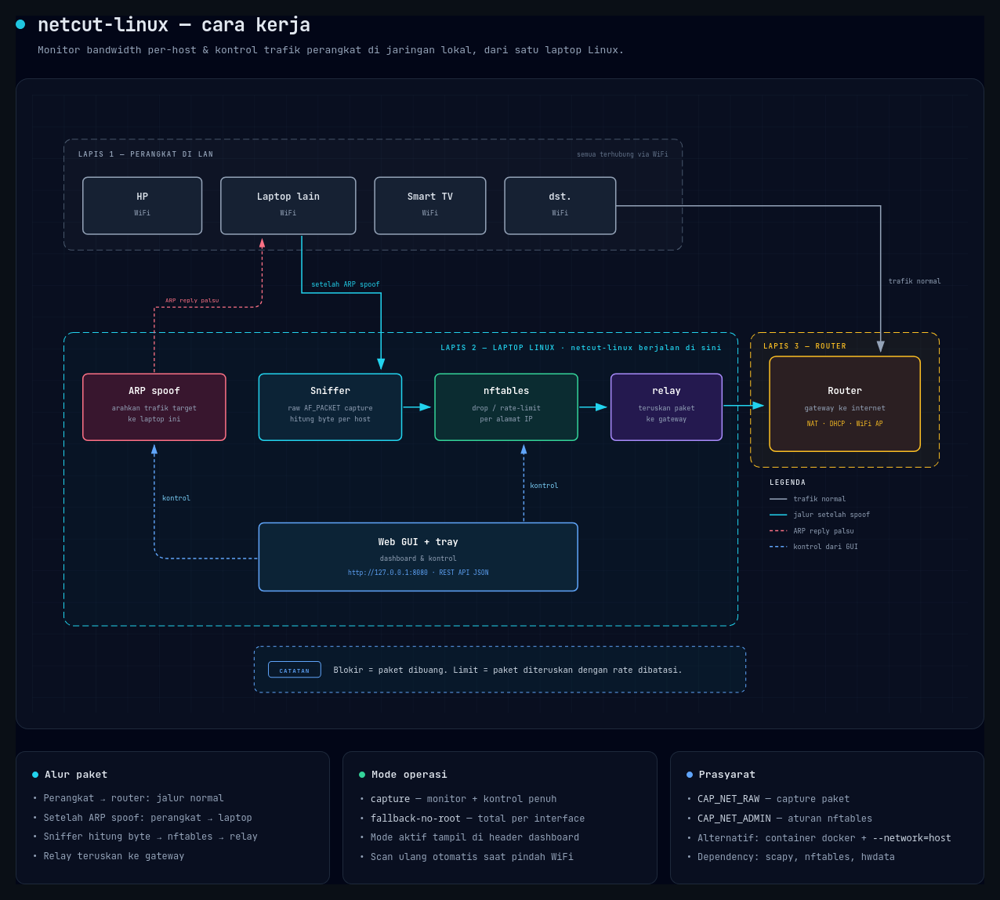

# netcut-linux

Monitor bandwidth per-host & kontrol trafik untuk jaringan lokal di Linux.

Terinspirasi dari **NetCut** untuk Windows — interface dan perilakunya serupa,
namun diimplementasikan ulang dengan tool Linux native.

[English](README.md) · **Bahasa Indonesia**


## Fitur

- **Monitoring real-time** per host: IP, MAC, vendor, download, upload, total
- **Blokir device** — memutus akses internet sebuah perangkat di jaringan
- **Batasi bandwidth** per device (kbps)
- **Lookup vendor** dari database OUI lokal
- **Discovery host** via ARP scan + cache ARP kernel
- **Web dashboard** dengan REST API JSON
- **Aplikasi Linux native**: launcher, entry app menu, system tray
- **Deteksi otomatis perpindahan WiFi** — scan ulang saat jaringan berganti

## Pemasangan

```bash
git clone https://github.com/Aryoksss/netcut-linux
cd netcut-linux
./install.sh
```

Launcher terpasang di `~/.local/bin/netcut` dan aplikasi muncul di app menu.

Alternatif tanpa instalasi:

```bash
./netcut.py --web      # dashboard di http://127.0.0.1:8080
```

### Dependency

| Paket | Debian/Ubuntu | Fedora |
|---|---|---|
| Scapy | `python3-scapy` | `python3-scapy` |
| nftables | `nftables` | `nftables` |
| OUI database | `hwdata` | `hwdata` |

### Privilege

Blokir & limit device lain butuh `CAP_NET_RAW` (capture) dan `CAP_NET_ADMIN`
(nftables). Launcher mengurusinya secara otomatis:

1. **Punya `CAP_NET_RAW`** → jalan langsung
2. **Bisa pakai docker** (user ada di grup `docker`) → server dijalankan di
   container dengan `--cap-add=NET_RAW --cap-add=NET_ADMIN --network=host`
3. **Else** → mode fallback: monitoring total interface saja, tanpa kontrol

Mode yang aktif terlihat di header dashboard: `capture` (penuh) atau
`fallback-no-root` (terbatas).

## Pemakaian

### CLI

```bash
netcut                          # buka web GUI + system tray
netcut --tray                   # hanya system tray
netcut --status                 # cek server jalan/tidak
netcut --stop                   # hentikan server

sudo ./netcut.py --once         # snapshot sekali
sudo ./netcut.py --json         # output JSON
sudo ./netcut.py --scan         # ARP scan
sudo ./netcut.py --block 192.168.1.50      # blokir device
sudo ./netcut.py --cut 192.168.1.50        # cut koneksi device
sudo ./netcut.py --limit 192.168.1.50 512  # batasi 512 kbps
sudo ./netcut.py --unblock 192.168.1.50    # lepas blokir
sudo ./netcut.py --list-rules               # aturan nftables aktif
```

### Web dashboard

```bash
sudo ./netcut.py --web --web-port 8080
```

- Tabel live per-host: IP, MAC, vendor, download, upload, total
- Sortir per kolom (klik header)
- Tombol **Blokir** / **Buka** dan **Limit** / **Buka limit** per baris
- Kartu ringkasan: total download, upload, host aktif, paket, trafik total
- **Scan ARP** (background, tidak membekukan UI)
- **Aturan nft** untuk melihat rule yang aktif
- Ganti interface langsung dari header

### REST API

| Endpoint | Method | Body | Fungsi |
|---|---|---|---|
| `/api/hosts` | GET | — | snapshot host + rate |
| `/api/rules` | GET | — | daftar aturan nftables aktif |
| `/api/block` | POST | `{"ip":"..."}` | blokir host |
| `/api/unblock` | POST | `{"ip":"..."}` | lepas blokir |
| `/api/limit` | POST | `{"ip":"...","kbps":512}` | batasi bandwidth |
| `/api/unlimit` | POST | `{"ip":"..."}` | lepas limit |
| `/api/scan` | POST | `{"net":"..."}` | ARP scan (background) |
| `/api/iface` | POST | `{"iface":"..."}` | ganti interface |

### System tray

Ikon di system tray menampilkan tooltip live: `netcut - <SSID>: <jumlah> host`.
Menu klik-kanan:

- **Buka Dashboard** — buka web GUI di browser
- **Scan ARP** — scan subnet aktif
- **Aturan nftables** — tampilkan rule aktif
- **Lepas Semua Blokir** — cabut blokir & limit
- **Keluar** — hentikan

Tray memakai `AppIndicator3` (protokol StatusNotifier) — di Wayland tray hanya
bisa lewat protokol itu. Notifikasi desktop muncul saat jaringan berubah atau
ada host diblokir.

### Keybind niri

Tambahkan ke `~/.config/niri/config.kdl`:

```
Mod+Shift+N hotkey-overlay-title="NetCut" {
    spawn "/home/aryoks/.local/bin/netcut";
}
```

## Cara kerja



Agar aturan di laptop bisa menyentuh trafik device lain, trafiknya perlu
melewati laptop lebih dulu. Hal itu dilakukan lewat ARP spoofing: korban diberi
tahu bahwa gateway berada di MAC laptop, sehingga trafiknya dialihkan ke
laptop — lalu baru bisa di-drop atau di-rate-limit di sini.

- Mode **Blokir** → paket masuk ke laptop lalu dibuang
- Mode **Limit** → paket masuk ke laptop, diteruskan ke gateway, tapi
  dibatasi rate-nya

Saat sebuah device diblokir, barisnya ditandai merah dengan badge status:


## Batasan yang diketahui

- **Access point WiFi membuang frame dengan source MAC asing.** Karena itu ARP
  reply dari MAC gateway tidak pernah sampai ke korban, dan frame relay harus
  memakai MAC laptop sendiri. Efeknya: saat blokir dilepas, cache ARP korban
  perlu expired sendiri sebelum kembali normal.

- **Router dengan proteksi ARP spoofing** (mis. beberapa router ISP) menolak
  spoofing ke sisi router. Akibatnya balasan download dari internet dikirim
  langsung ke device, melewati laptop — sehingga **limit hanya berlaku untuk
  arah upload** di router seperti itu. Tool mendeteksi hal ini otomatis dan
  menampilkan badge peringatan. Untuk membatasi total, gunakan **Blokir**.

- **Limit memakai token bucket**, jadi ada burst di awal. Nilai rata-rata
  aktual sedikit di bawah nominal.

- Aturan nftables berlaku untuk trafik **milik mesin ini**. Untuk membatasi
  perangkat lain secara permanen, pasang aturan di router.

## Ganti WiFi otomatis

Tool memantau perpindahan jaringan setiap 3 detik. Begitu kamu pindah WiFi atau
ganti hotspot, tool otomatis mengembalikan ARP cache korban, menghapus rule
lama, membuang daftar host dari subnet sebelumnya, dan menjalankan scan ARP
subnet baru.

## Test

```bash
python3 test_parser.py     # 9 unit test, tanpa root
sudo python3 test_suite.py # 28 test end-to-end di jaringan virtual terisolasi
```

Test end-to-end memakai `veth` + network namespace sehingga tidak menyentuh
jaringan host, dan otomatis di-skip bila `CAP_NET_ADMIN` tidak tersedia.

## Regenerasi screenshot

Gambar di README dibuat dari HTML dashboard asli dengan data demo sintetis,
jadi tidak memuat SSID atau MAC jaringan siapa pun:

```bash
python3 tools/make_screenshots.py   # butuh firefox + Pillow
```

## Kontribusi

Lihat [CONTRIBUTING.md](CONTRIBUTING.md).

## Lisensi

MIT — lihat [LICENSE](LICENSE).

> ARP spoofing adalah teknik MITM yang bisa mengarah ke penyalahgunaan.
> Gunakan hanya untuk perangkat milik sendiri di jaringan sendiri.
