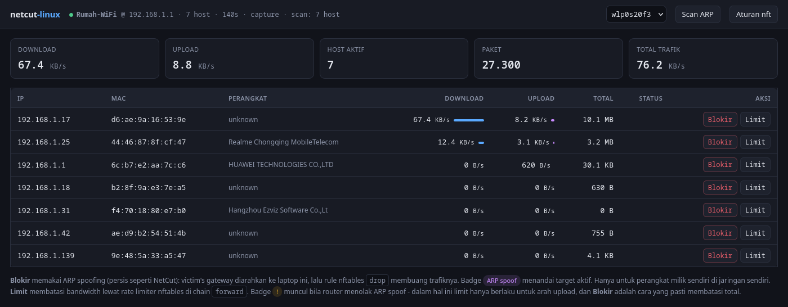
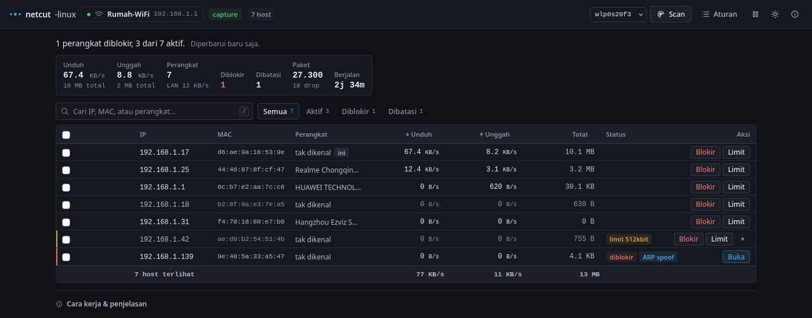
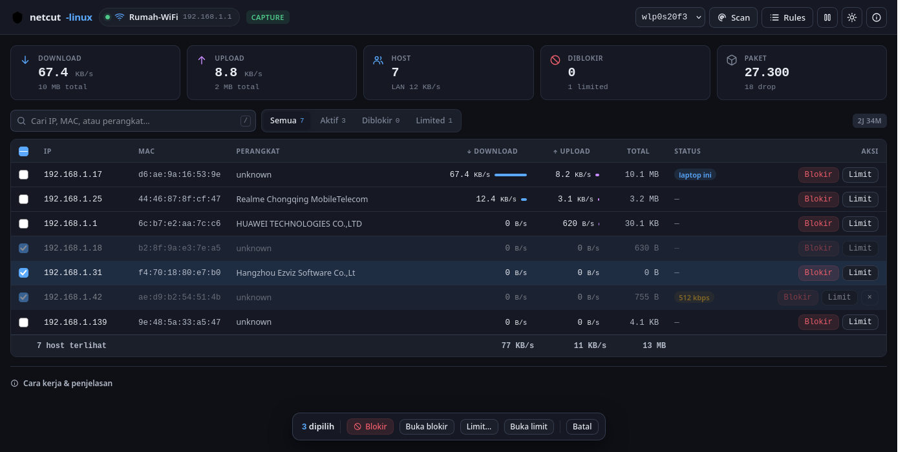
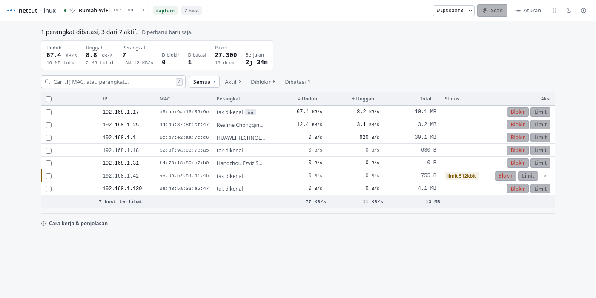
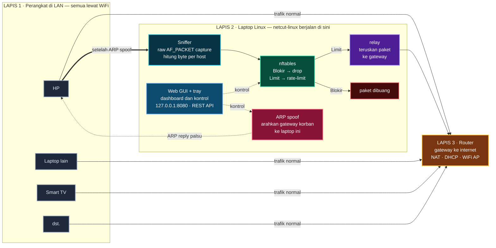

# netcut-linux

Monitor bandwidth per-host & kontrol trafik untuk jaringan lokal di Linux.

Terinspirasi dari **NetCut** untuk Windows — interface dan perilakunya serupa,
namun diimplementasikan ulang dengan tool Linux native.

[English](README.md) · **Bahasa Indonesia**



## Fitur

- **Monitoring real-time** per host: IP, MAC, vendor, download, upload, total
- **Blokir device** — memutus akses internet sebuah perangkat di jaringan
- **Batasi bandwidth** per device (kbps)
- **Aksi massal** — pilih banyak perangkat sekaligus, lalu blokir/buka/limit
  semuanya dalam satu klik
- **Cari & filter** — pencarian IP/MAC/perangkat + filter Aktif/Diblokir/Limited
- **Lookup vendor** dari database OUI lokal
- **Discovery host** via ARP scan + cache ARP kernel
- **Web dashboard** dengan REST API JSON
- **Tema gelap & terang** (dark-first, tombol ganti +remember)
- **Aplikasi Linux native**: launcher, entry app menu, system tray
- **Deteksi otomatis perpindahan WiFi** — scan ulang saat jaringan berganti

## Pemasangan

### Docker (paling gampang)

```bash
git clone https://github.com/Aryoksss/netcut-linux
cd netcut-linux
docker compose up -d
```

Dashboard langsung jalan di **http://127.0.0.1:8080**. Image-nya mandiri
saja: Python, scapy, nftables, dan database OUI sudah di dalam, jadi tidak
perlu mount filesystem host.

```bash
docker compose logs -f   # lihat log
docker compose down      # hentikan
```

Atau tanpa compose:

```bash
docker build -t netcut-linux .
docker run --rm -d --name netcut \
  --network=host \
  --cap-add=NET_RAW --cap-add=NET_ADMIN \
  netcut-linux
```

Dua hal yang wajib:

- **`--network=host`** — ARP spoofing dan relay harus bekerja pada interface
  host yang asli. Tanpa itu container ada di network namespace sendiri dan
  tidak akan melihat LAN sama sekali.
- **`--cap-add=NET_RAW --cap-add=NET_ADMIN`** — untuk capture paket dan
  aturan nftables.

### Native (launcher)

```bash
git clone https://github.com/Aryoksss/netcut-linux
cd netcut-linux
./install.sh          # cek dependency + pasang launcher
netcut --doctor       # pastikan environment sudah siap
netcut                # buka dashboard + system tray
```

`install.sh` mengecek dependency dulu dan menawarkan menambahkannya ke
`~/.bashrc` supaya `netcut` bisa dipanggil dari mana saja. Kalau mau
dependency ikut dipasang:

```bash
sudo ./install.sh --with-deps
```

Launcher terpasang di `~/.local/bin/netcut` dan aplikasi muncul di app menu.

Alternatif tanpa instalasi:

```bash
./netcut.py --web      # dashboard di http://127.0.0.1:8080
```

### Dependency

| Paket | Debian/Ubuntu | Fedora |
|---|---|---|
| Scapy | `python3-scapy` | `python3-scapy` |
| nftables | `nftables` | `nftables` |
| OUI database | `hwdata` | `hwdata` |

`netcut --doctor` cek semua ini sekaligus beserta hak akses dan mode yang
akan dipakai.

### Privilege

Blokir & limit device lain butuh `CAP_NET_RAW` (capture) dan `CAP_NET_ADMIN`
(nftables). Launcher mengurusinya secara otomatis:

1. **Punya `CAP_NET_RAW`** → jalan langsung
2. **Bisa pakai docker** (user ada di grup `docker`) → server dijalankan di
   container dengan `--cap-add=NET_RAW --cap-add=NET_ADMIN --network=host`
3. **Else** → mode fallback: monitoring total interface saja, tanpa kontrol

Mode yang aktif terlihat di header dashboard: `capture` (penuh) atau
`fallback-no-root` (terbatas). Di mode fallback, dashboard menampilkan
banner kuning dan tombol Blokir/Limit dimatikan dari awal, jadi tidak ada
klik yang gagal tanpa penjelasan. `netcut --doctor` menyebutkan cara
mengaktifkan mode penuh.

## Pemakaian

### CLI

```bash
netcut                          # buka web GUI + system tray
netcut --tray                   # hanya system tray
netcut --doctor                 # cek dependency, hak akses, mode, status server
netcut --status                 # cek status server (URL, mode, jumlah host)
netcut --stop                   # hentikan server
netcut --port 8090              # pakai porta lain
netcut --no-tray                # server tanpa ikon system tray
netcut --help                   # bantuan

sudo ./netcut.py --once         # snapshot sekali
sudo ./netcut.py --json         # output JSON
sudo ./netcut.py --scan         # ARP scan
sudo ./netcut.py --block 192.168.1.50      # blokir device
sudo ./netcut.py --cut 192.168.1.50        # cut koneksi device
sudo ./netcut.py --limit 192.168.1.50 512  # batasi 512 kbps
sudo ./netcut.py --unblock 192.168.1.50    # lepas blokir
sudo ./netcut.py --list-rules               # aturan nftables aktif
```

### Web dashboard

```bash
sudo ./netcut.py --web --web-port 8080
```

- Tabel live per-host: IP, MAC, vendor, download, upload, total
- Sortir per kolom (klik header, **tanpa** request ke server)
- **Cari** IP/MAC/perangkat + **filter** Semua / Aktif / Diblokir / Limited
- **Multi-select**: centang atau klik baris untuk menyelect beberapa
  perangkat, lalu pakai bilah aksi massal untuk blokir/buka/limit sekaligus
- Tombol **Blokir** / **Buka** dan **Limit** / **Buka limit** per baris
- Dialog limit dengan preset (128/256/512/1024/2048 kbps) — bukan `prompt()`
- Kartu ringkasan: total download, upload, host aktif, jumlah diblokir, paket
- Baris total di kaki tabel, dan baris idle (>45s) diredupkan
- **Scan ARP** (background, tidak membekukan UI)
- **Aturan nft** dalam dialog yang bisa disalin
- Ganti interface langsung dari header
- **Jeda polling** (`P`), ganti tema (`T`), bantuan (`?`)
- Poll berhenti otomatis saat tab browser tidak aktif



**Aksi massal** — pilih beberapa perangkat, lalu blokir sekaligus:



Tema terang (tombol sun di header):



#### Pintasan keyboard

| Pintasan | Fungsi |
|---|---|
| `/` | Fokus ke kolom pencarian |
| `Ctrl`+`A` | Pilih semua perangkat yang tampil |
| `Esc` | Tutup dialog / bersihkan pencarian |
| `S` | Scan ARP |
| `R` | Lihat aturan nftables |
| `P` | Jeda / lanjut polling |
| `T` | Ganti tema |

### REST API

| Endpoint | Method | Body | Fungsi |
|---|---|---|---|
| `/api/hosts` | GET | — | snapshot host + rate |
| `/api/rules` | GET | — | daftar aturan nftables aktif |
| `/api/block` | POST | `{"ip":"..."}` | blokir host |
| `/api/unblock` | POST | `{"ip":"..."}` | lepas blokir |
| `/api/limit` | POST | `{"ip":"...","kbps":512}` | batasi bandwidth |
| `/api/unlimit` | POST | `{"ip":"..."}` | lepas limit |
| `/api/bulk` | POST | `{"ips":[...],"action":"block\|unblock\|limit\|unlimit","kbps":512}` | aksi massal (diproses paralel) |
| `/api/scan` | POST | `{"net":"..."}` | ARP scan (background) |
| `/api/iface` | POST | `{"iface":"..."}` | ganti interface |

### System tray

Ikon di system tray menampilkan tooltip live: `netcut - <SSID>: <jumlah> host`
(plus jumlah yang diblokir/limited). Ikon berubah jadi attention ketika ada
perangkat yang diblokir. Menu klik-kanan:

- **Buka Dashboard** — buka web GUI di browser
- **Scan ARP** — scan subnet aktif
- **Blokir cepat…** — dialog checklist zenity, pilih banyak perangkat lalu
  blokir sekaligus
- **Buka blokir / limit…** — dialog checklist untuk melepas blokir/limit
- **Aturan nftables** — tampilkan rule aktif
- **Lepas Semua Blokir** — cabut blokir & limit
- **Keluar** — hentikan

Tray memakai `AppIndicator3` (protokol StatusNotifier) — di Wayland tray hanya
bisa lewat protokol itu. Notifikasi desktop muncul saat jaringan berubah atau
ada host diblokir/dibatasi.


### Keybind niri

Tambahkan ke `~/.config/niri/config.kdl`:

```
Mod+Shift+N hotkey-overlay-title="NetCut" {
    spawn "/home/aryoks/.local/bin/netcut";
}
```

## Cara kerja

<!-- diagram:architecture -->

<!-- /diagram:architecture -->

Agar aturan di laptop bisa menyentuh trafik device lain, trafiknya perlu
melewati laptop lebih dulu. Hal itu dilakukan lewat ARP spoofing: korban diberi
tahu bahwa gateway berada di MAC laptop, sehingga trafiknya dialihkan ke
laptop — lalu baru bisa di-drop atau di-rate-limit di sini.

- Mode **Blokir** → paket masuk ke laptop lalu dibuang
- Mode **Limit** → paket masuk ke laptop, diteruskan ke gateway, tapi
  dibatasi rate-nya

| | |
|---|---|
| **Alur paket** | Perangkat → router: jalur normal · Setelah ARP spoof: perangkat → laptop · Sniffer hitung byte → nftables → relay · Relay teruskan ke gateway |
| **Mode operasi** | `capture` — monitor + kontrol penuh · `fallback-no-root` — total per interface · Mode aktif tampil di header dashboard · Scan ulang otomatis saat pindah WiFi |
| **Prasyarat** | `CAP_NET_RAW` — capture paket · `CAP_NET_ADMIN` — aturan nftables · Alternatif: container docker + `--network=host` · Dependency: scapy, nftables, hwdata |

## Batasan yang diketahui

- **Access point WiFi membuang frame dengan source MAC asing.** Karena itu ARP
  reply dari MAC gateway tidak pernah sampai ke korban, dan frame relay harus
  memakai MAC laptop sendiri. Efeknya: saat blokir dilepas, cache ARP korban
  perlu expired sendiri sebelum kembali normal.

- **Router dengan proteksi ARP spoofing** (mis. beberapa router ISP) menolak
  spoofing ke sisi router. Akibatnya balasan download dari internet dikirim
  langsung ke device, melewati laptop — sehingga **limit hanya berlaku untuk
  arah upload** di router seperti itu. Tool mendeteksi hal ini otomatis dan
  menampilkan badge peringatan. Untuk membatasi total, gunakan **Blokir**.

- **Limit memakai token bucket**, jadi ada burst di awal. Nilai rata-rata
  aktual sedikit di bawah nominal.

- **Firewall host yang membuang trafik forward membuat Limit tidak berlaku.**
  Di Linux, verdict `accept` di satu rantai nftables **tidak** menghentikan
  hook — rantai lain yang lebih lambat tetap jalan. Kalau host punya rantai
  `forward` dengan `policy drop` (default Ubuntu & Debian), trafik korban
  yang dialihkan ke laptop tetap dibuang, sehingga **Limit** jadi
  seperti **Blokir**. `netcut --doctor` mendeteksi kondisi ini, dan
  dashboard menampilkan banner peringatan kalauLimit dipasang.
  Solusinya: pakai **Blokir**, atau longgarkan firewall host (mis. izinkan
  trafik dari perangkat target).

- Aturan nftables berlaku untuk trafik **milik mesin ini**. Untuk membatasi
  perangkat lain secara permanen, pasang aturan di router.

## Ganti WiFi otomatis

Tool memantau perpindahan jaringan setiap 3 detik. Begitu kamu pindah WiFi atau
ganti hotspot, tool otomatis mengembalikan ARP cache korban, menghapus rule
lama, membuang daftar host dari subnet sebelumnya, dan menjalankan scan ARP
subnet baru.

## Test

```bash
python3 test_parser.py     # 9 unit test, tanpa root
sudo python3 test_suite.py # 28 test end-to-end di jaringan virtual terisolasi
python3 tools/ui_test.py --serve   # 44 test UI dashboard (butuh playwright)
```

Test end-to-end memakai `veth` + network namespace sehingga tidak menyentuh
jaringan host, dan otomatis di-skip bila `CAP_NET_ADMIN` tidak tersedia.

Test UI memakai Chromium (Playwright) terhadap server demo berisi data
sintetis — tidak menyentuh jaringan asli sama sekali.

## Regenerasi screenshot

Gambar di README dibuat dari HTML dashboard asli dengan data demo sintetis,
jadi tidak memuat SSID atau MAC jaringan siapa pun:

```bash
python3 tools/make_screenshots.py   # butuh firefox + Pillow
```

Database OUI (`assets/oui.txt`) dipakai image Docker supaya build tidak
perlu jaringan. Untuk menyegarkan:

```bash
curl -sL https://standards-oui.ieee.org/oui/oui.csv -o /tmp/oui.csv
python3 tools/oui_csv_to_hwdata.py /tmp/oui.csv assets/oui.txt
```

Diagram arsitektur bukan gambar, tapi **Mermaid** — GitHub merendernya
langsung di README sehingga tetap tajam dan bisa dicari. Sumbernya ada di
`assets/architecture.mmd` (Indonesia) dan `assets/architecture.en.mmd`
(Inggris). Karena README harus berisi bloknya secara inline, sinkronisasi
dilakukan otomatis:

```bash
python3 tools/sync_diagram.py           # perbarui blok di kedua README
python3 tools/sync_diagram.py --check   # cek saja (dipakai CI)
```

## Kontribusi

Lihat [CONTRIBUTING.md](CONTRIBUTING.md).

## Lisensi

MIT — lihat [LICENSE](LICENSE).

> ARP spoofing adalah teknik MITM yang bisa mengarah ke penyalahgunaan.
> Gunakan hanya untuk perangkat milik sendiri di jaringan sendiri.
