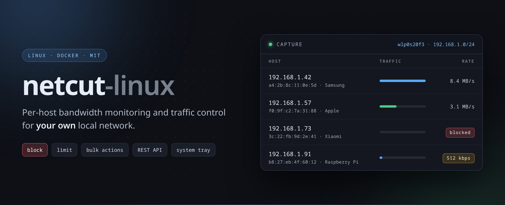
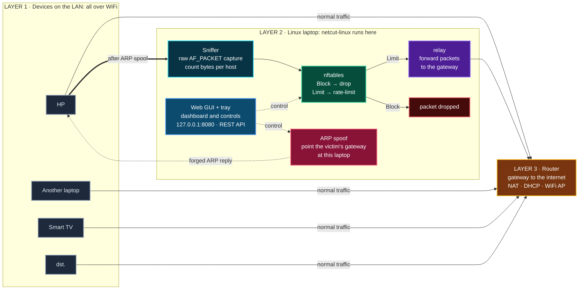

# netcut-linux

[](https://github.com/Aryoksss/netcut-linux/actions/workflows/test.yml)
[](https://github.com/Aryoksss/netcut-linux/releases/latest)
[](https://github.com/Aryoksss/netcut-linux/pkgs/container/netcut-linux)
[](LICENSE)
[](#requirements)

Per-host bandwidth monitoring and traffic control for your own local network.
Inspired by **NetCut** for Windows, the interface and behaviour are similar,
but it is reimplemented with native Linux tooling.

**English** · [Bahasa Indonesia](README.id.md)



> **Use it on devices and networks you own.** Blocking and limiting work
> through ARP spoofing, a MITM technique that can be abused. See
> [License](#license).

**Contents** · [Features](#features) · [Installation](#installation) ·
[Usage](#usage) · [How it works](#how-it-works) ·
[Known limitations](#known-limitations) · [Tests](#tests) ·
[Development](#development) · [License](#license)

## Features

- **Real-time monitoring** per host: IP, MAC, vendor, download, upload, total
- **Device names**: from DHCP, mDNS, NetBIOS, or reverse DNS; click a name
  to give it your own label (saved locally)
- **Block a device**: cut a device's internet access on the network
- **Bandwidth limiting** per device (kbps)
- **Bulk actions**: select many devices at once, then block, unblock or limit
  them all in one go
- **Search & filter**: by IP/MAC/vendor, plus Active/Blocked/Limited filters
- **Vendor lookup** from the local OUI database
- **Host discovery** via ARP scan + kernel ARP cache
- **Web dashboard** with a JSON REST API
- **Dark & light themes** (dark-first, with a toggle that remembers your pick)
- **Native Linux app**: launcher, app menu entry, system tray
- **Automatic WiFi change detection**: rescan when the network changes

The dashboard, running against demo data:


## Installation

### Docker (recommended)

The image is published to GHCR, so there is nothing to build:

```bash
docker pull ghcr.io/aryoksss/netcut-linux:latest

docker run -d --name netcut \
  --network=host \
  --cap-add=NET_RAW --cap-add=NET_ADMIN \
  -e NETCUT_STATE_DIR=/var/lib/netcut \
  -v netcut-state:/var/lib/netcut \
  --restart unless-stopped \
  ghcr.io/aryoksss/netcut-linux:latest
```

The dashboard is up at **http://127.0.0.1:8080**.

```bash
docker logs -f netcut     # follow the logs
docker rm -f netcut       # stop and remove
```

Available tags: `latest`, version tags (`<major>.<minor>.<patch>` and
`<major>.<minor>`), and `sha-<commit>`.

<details>
<summary>Alternative: docker compose</summary>

```bash
git clone https://github.com/Aryoksss/netcut-linux
cd netcut-linux
docker compose pull      # fetch the image from GHCR
docker compose up -d
```

</details>

<details>
<summary>Alternative: build from source</summary>

```bash
git clone https://github.com/Aryoksss/netcut-linux
cd netcut-linux
docker compose up -d --build
```

The image is fully self-contained, Python, scapy, nftables and the OUI
database are baked in, so no host filesystem mounts are needed. The first
build downloads Debian packages (~1–2 minutes without cache).

</details>

#### Does it work on the real LAN/WiFi?

Yes. With `--network=host` the container uses the host's interfaces directly,
so what it sees is your real WiFi/LAN, not the Docker bridge. Output from the
GHCR image on a laptop connected over WiFi:

```
mode  : capture
iface : wlan0              <- the host's WiFi interface, not the Docker bridge
net   : 192.168.0.0/24     <- your real LAN subnet
hosts : 3                  <- other devices on that network
```

### Requirements

- **Linux.** This is a hard requirement, not a preference: `network_mode: host`
  on Docker Desktop (macOS/Windows) points at the VM's network instead of your
  LAN, so ARP spoofing never reaches the real network. On those platforms
  neither the container nor the native mode can control other devices.
- **`--network=host`** and **`--cap-add=NET_RAW --cap-add=NET_ADMIN`**: ARP
  spoofing and the relay must run on the host's real interfaces, and the
  nftables rules need `NET_ADMIN`. Without host networking the container sits
  in its own network namespace and sees no LAN at all.
- **Your user in the `docker` group**: otherwise you get `permission denied`
  talking to the Docker daemon. Fix with `sudo usermod -aG docker $USER`, then
  log out and back in.

One consequence worth knowing: with `--network=host` the container shares the
host's network namespace, so its nftables rules apply to the host too. That is
required, without it, other devices' traffic cannot be intercepted.

### Native (launcher)

```bash
git clone https://github.com/Aryoksss/netcut-linux
cd netcut-linux
./install.sh          # check dependencies + install the launcher
netcut --doctor       # make sure the environment is ready
netcut                # open the dashboard + system tray
```

`install.sh` verifies the dependencies first and offers to add `~/.local/bin`
to `~/.bashrc` so `netcut` can be called from anywhere. The launcher lands in
`~/.local/bin/netcut` and the app appears in your application menu. To install
the dependencies as well:

```bash
sudo ./install.sh --with-deps
```

Without installing anything:

```bash
./netcut.py --web      # dashboard at http://127.0.0.1:8080
```

### Dependencies

| Package | Debian/Ubuntu | Fedora |
|---|---|---|
| Scapy | `python3-scapy` | `python3-scapy` |
| nftables | `nftables` | `nftables` |
| OUI database | `hwdata` | `hwdata` |

`netcut --doctor` checks all of these at once, together with your privileges
and the mode that will be used.

### Privileges

Blocking and limiting other devices requires `CAP_NET_RAW` (capture) and
`CAP_NET_ADMIN` (nftables). The launcher picks a privilege path automatically:

1. **Has `CAP_NET_RAW`** → runs directly
2. **Docker available** (user is in the `docker` group) → server runs in a
   container with `--cap-add=NET_RAW --cap-add=NET_ADMIN --network=host`
3. **Otherwise** → fallback mode: whole-interface monitoring only, no control

The active mode is shown in the dashboard header: `capture` (full) or
`fallback-no-root` (limited). In fallback mode the dashboard shows an amber
banner and the Block/Limit buttons are disabled up front, so nothing fails on
click without an explanation. `netcut --doctor` tells you how to enable the
full mode.

## Usage

### Launcher

```bash
netcut                          # open web GUI + system tray
netcut --tray                   # system tray only
netcut --doctor                 # check deps, privileges, mode, server status
netcut --status                 # server status (URL, mode, host count)
netcut --stop                   # stop the server
netcut --port 8090              # use a different port
netcut --no-tray                # run the server without a tray icon
netcut --version                # print the version
netcut --help                   # help
```

### Direct script

Useful for scripting or when you skip the launcher. These need root:

```bash
sudo ./netcut.py --once                     # single snapshot
sudo ./netcut.py --json                     # JSON output
sudo ./netcut.py --scan                     # ARP scan
sudo ./netcut.py --block 192.168.1.50       # block a device
sudo ./netcut.py --cut 192.168.1.50         # cut a device's connection
sudo ./netcut.py --limit 192.168.1.50 512   # limit to 512 kbps
sudo ./netcut.py --unblock 192.168.1.50     # remove block
sudo ./netcut.py --list-rules               # active nftables rules
```

### Web dashboard

```bash
sudo ./netcut.py --web --web-port 8080
```

- Live per-host table: IP, MAC, vendor, download, upload, total
- Sort by column (click a header), entirely client side, no server round-trip
- **Search** by IP/MAC/vendor, plus **filters** for All / Active / Blocked / Limited
- **Multi-select**: tick a checkbox or click a row to select several devices,
  then use the bulk action bar to block, unblock or limit them all at once
- **Block** / **Unblock** and **Limit** / **Remove limit** buttons per row
- Limit dialog with presets (128/256/512/1024/2048 kbps) instead of `prompt()`
- Summary cards: total download, upload, active hosts, blocked count, packets
- Table footer with totals; idle rows (>45s) are dimmed
- **ARP scan** (background, does not freeze the UI)
- **nft rules** in a copyable dialog
- Switch interface directly from the header
- **Pause polling** (`P`), toggle theme (`T`), help (`?`)
- Polling stops automatically while the browser tab is in the background


**Bulk actions**: select several devices, then block them all at once:


Light theme (the sun button in the header):


#### Keyboard shortcuts

| Shortcut | Action |
|---|---|
| `/` | Focus the search box |
| `Ctrl`+`A` | Select every visible device |
| `Esc` | Close a dialog / clear the search |
| `S` | ARP scan |
| `R` | Show nftables rules |
| `P` | Pause / resume polling |
| `T` | Toggle theme |

### Device names

A host is labelled from the first source that answers, in this order:

1. **DHCP**: hostname option (12) and vendor class (60) from the device's own
   DHCP request. This is the usual source for phones, and it also catches the
   device type (e.g. `android-dhcp-14`).
2. **mDNS**: reverse PTR query, answered by Apple/Android/Linux devices.
3. **NetBIOS**: node status query on UDP 137, answered by Windows machines.
4. **Reverse DNS**: PTR through the system resolver, when your router
   registers DHCP names.

Devices that answer none of these (some phones keep quiet) still show IP, MAC
and vendor. Click the device name in the dashboard to give it a label of your
own, it is stored locally and survives restarts.

### REST API

| Endpoint | Method | Body | Purpose |
|---|---|---|---|
| `/api/hosts` | GET |, | host snapshot + rates |
| `/api/rules` | GET |, | active nftables rules |
| `/api/block` | POST | `{"ip":"..."}` | block a host |
| `/api/unblock` | POST | `{"ip":"..."}` | unblock a host |
| `/api/limit` | POST | `{"ip":"...","kbps":512}` | limit bandwidth |
| `/api/unlimit` | POST | `{"ip":"..."}` | remove limit |
| `/api/bulk` | POST | `{"ips":[...],"action":"block\|unblock\|limit\|unlimit","kbps":512}` | bulk action (processed in parallel) |
| `/api/scan` | POST | `{"net":"..."}` | ARP scan (background) |
| `/api/iface` | POST | `{"iface":"..."}` | switch interface |
| `/api/name` | POST | `{"ip":"...","name":"HP Andi"}` | set (or clear) a device label |

### System tray

The tray icon shows a live tooltip: `netcut - <SSID>: <host count>` (plus how
many devices are blocked or limited). The icon switches to an attention state
while devices are blocked. Right-click menu:

- **Open Dashboard**: open the web GUI in your browser
- **ARP Scan**: scan the active subnet
- **Quick block…**: a zenity checklist, pick many devices and block them at once
- **Unblock / remove limit…**: a checklist for lifting blocks and limits
- **nftables Rules**: show the active ruleset
- **Remove All Blocks**: clear blocks & limits
- **Quit**: stop

The tray uses `AppIndicator3` (StatusNotifier protocol), on Wayland that is
the only way to get a tray icon. Desktop notifications appear when the network
changes or a host is blocked/limited.

### niri keybind

Add to `~/.config/niri/config.kdl`:

```
Mod+Shift+N hotkey-overlay-title="NetCut" {
    spawn "/home/aryoks/.local/bin/netcut";
}
```

## How it works

<!-- diagram:architecture -->

<!-- /diagram:architecture -->

For rules on your laptop to affect another device's traffic, that traffic has
to pass through the laptop first. That is achieved with ARP spoofing: the
victim is told the gateway lives at the laptop's MAC, so its traffic is
redirected to the laptop, and only then can it be dropped or rate-limited
here.

**Packet flow**: devices → router is the normal path. After the ARP spoof:
devices → laptop, the sniffer counts bytes, nftables decides, the relay
forwards to the gateway.

**Operating modes**: `capture` gives full monitoring and control;
`fallback-no-root` gives per-interface totals only. The active mode is shown
in the dashboard header, and the tool rescans automatically when the WiFi
changes.

**Privileges**: `CAP_NET_RAW` for packet capture, `CAP_NET_ADMIN` for the
nftables rules. The container path supplies both; the native path needs
`sudo` or those capabilities.

## Known limitations

- **WiFi access points drop frames with a foreign source MAC.** Because of
  that, an ARP reply from the gateway's MAC never reaches the victim, and
  relay frames must use the laptop's own MAC. As a result, when a block is
  removed the victim's ARP cache has to expire on its own before things return
  to normal.

- **Routers with ARP spoofing protection** (e.g. some ISP routers) reject
  spoofing towards the router side. Download replies from the internet are then
  sent straight to the device, bypassing the laptop, so **limiting only
  applies to the upload direction** on such routers. The tool detects this
  automatically and shows a warning badge. To cap total traffic, use **Block**.

- **Limiting uses a token bucket**, so there is a burst at the start. The
  actual average ends up slightly below the nominal value.

- **A host firewall that drops forwarded traffic makes limiting ineffective.**
  In Linux, an `accept` verdict in one nftables chain does **not** stop the
  hook, later chains still run. If the host has a `forward` chain with
  `policy drop` (the default on Ubuntu & Debian), the victim's diverted
  traffic is still discarded, so **Limit** behaves like **Block**.
  `netcut --doctor` detects this, and the dashboard shows a warning banner
  once a limit is installed. Workarounds: use **Block**, or relax the host
  firewall (e.g. allow traffic from the target device).

- nftables rules apply to **this machine's own traffic**. To permanently
  constrain other devices, put rules on the router.

## Automatic WiFi switching

The tool watches for network changes every 3 seconds. As soon as you switch
WiFi or change hotspot, it restores the victims' ARP caches, removes old
rules, drops the host list from the previous subnet, and runs an ARP scan on
the new subnet.

## Tests

```bash
python3 test_parser.py             # 9 unit tests, no root required
sudo python3 test_suite.py         # end-to-end tests on an isolated virtual network
python3 tools/ui_test.py --serve   # 44 dashboard UI tests (needs playwright)
```

`test_suite.py` defines 28 checks; the ones that need `CAP_NET_ADMIN` or
working forwarding between namespaces are skipped automatically, so a
restricted host runs 21 of them. The end-to-end tests use `veth` + network
namespaces and never touch the host network. The UI tests drive Chromium
(Playwright) against a demo server filled with synthetic data.

## Development

Screenshots and the hero banner are rendered from real HTML with synthetic
demo data, so they contain no one's SSID or MAC addresses:

```bash
python3 tools/make_screenshots.py   # README screenshots (firefox + Pillow)
python3 tools/make_hero.py          # hero banner (playwright + chromium)
```

The architecture diagram is not an image but **Mermaid**: GitHub renders it
directly inside the README, so it stays sharp at any size and is searchable.
Its source lives in `assets/architecture.mmd` (Indonesian) and
`assets/architecture.en.mmd` (English). Because the README has to inline the
block, the sync is automated:

```bash
python3 tools/sync_diagram.py           # update the block in both READMEs
python3 tools/sync_diagram.py --check   # check only (used by CI)
```

The OUI database (`assets/oui.txt`) is bundled so the Docker image builds
without network access. To refresh it:

```bash
curl -sL https://standards-oui.ieee.org/oui/oui.csv -o /tmp/oui.csv
python3 tools/oui_csv_to_hwdata.py /tmp/oui.csv assets/oui.txt
```

## Design

The dashboard has a written direction in [DESIGN.md](DESIGN.md): who opens it, the one
question the screen answers, the palette with measured contrast ratios, the density
rules, and the reason for every decision. The UI is built against that direction and
then filtered for the usual generated-design tells: no KPI card row, no glowing status
dot, no uppercase tracking, no pill controls, one accent used in three places.

The screen opens with a sentence rather than a number: how many devices are blocked or
limited, how many are active, and how old the data is. If the collector dies, that
sentence says so instead of showing a calm zero.

## Contributing

See [CONTRIBUTING.md](CONTRIBUTING.md).

## License

MIT, see [LICENSE](LICENSE).

> ARP spoofing is a MITM technique that can be abused.
> Use it only on devices you own, on your own network.
